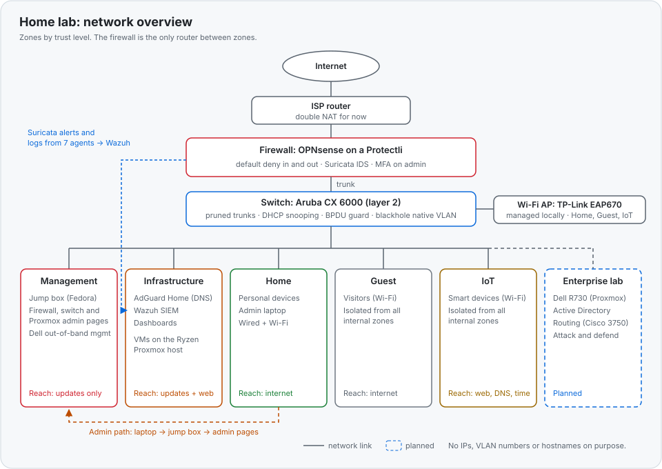

## Summary

I built my home network the way a small company would: separate zones by trust level, a firewall that blocks everything by default, one jump box for all admin access, and a SIEM collecting logs from my machines.

This is part 2 of my home lab posts. Part 1 was about why I started. This one is about how it's built, why I made the choices I made, and the mistakes that took me the longest to figure out.

## How it started

I knew the concepts from school and work, like VLANs, firewalls and IDS, but I had never had them all working together in one place that I fully controlled. So I started buying used enterprise hardware and building it myself.

I had two goals from the start: simulate a real company environment, and still have a home network that's secure and easy to live with. So from the beginning the network was split into two parts:

- **Home:** the part my household actually uses every day. It's mostly finished now. Everything on it is monitored, and it's built so I can add a Plex media server, security cameras with their own camera server, and Home Assistant later, so I can control the house without handing that control to cloud services.
- **Enterprise:** my lab, built like a small company network: Active Directory and the other services a company runs, layer 3 routing between networks (that's what the Cisco Catalyst 3750 is for), and room to attack and defend it all. This is where I build things, break them, and learn how to fix them, without taking down the network at home. Most of this part is still ahead of me.

That split shows up everywhere below: the everyday services run on one server, the lab work on another, and they're kept apart so a lab experiment can't take down the home network.

A few early decisions shaped the rest:

- I bought a Ubiquiti access point and returned it, because it depended on a cloud connection. I replaced it with a TP-Link EAP670 that I manage locally through Omada. I didn't want my Wi-Fi to depend on someone else's cloud.
- I bought a Qotom mini PC to use as the firewall, then decided not to trust it with that job, because I couldn't verify where the hardware came from. It's set aside as a future honeypot, where untrusted hardware is fine. The firewall is a Protectli appliance running OPNsense.
- My first switch, a Cisco Catalyst 2960-X, lost its whole configuration because of a failing NVRAM. I replaced it with an Aruba CX 6000 and moved the configuration over by hand. After that I started documenting everything and keeping configs as code.

## What's in the lab

- **Firewall:** Protectli appliance with OPNsense
- **Switch:** Aruba CX 6000
- **Wi-Fi:** TP-Link EAP670, managed locally
- **Servers:** a Ryzen machine running Proxmox for everyday services, and a Dell PowerEdge R730 for lab work
- **Jump box:** a small Lenovo running Fedora
- **Security tools:** Suricata IDS, Wazuh SIEM, AdGuard Home for DNS filtering

*The network at a glance: zones by trust level, the admin path through the jump box, and where the logs go. No IPs, VLAN numbers or hostnames on purpose.*

## The design

Every system belongs to one of three trust levels: the control plane, infrastructure services, and everything else. How much I trust a system decides which zone it goes in. What it does decides which server it runs on.

Five zones are live right now:

| Zone | What's in it | What it can reach |
|---|---|---|
| Management | Jump box, firewall, switch and hypervisor admin pages, out-of-band management | Updates only |
| Infrastructure | DNS filtering, the SIEM, internal dashboards | Updates and web |
| Home | Personal devices | Internet |
| Guest | Visitors | Internet, nothing internal |
| IoT | Smart devices | Web, DNS and time only, nothing internal |

There's also a "blackhole" VLAN set as the native VLAN on every trunk, so untagged traffic goes nowhere. The firewall is the only thing that routes between zones.

Infrastructure is separate from management on purpose. If my DNS filter or SIEM ever has a vulnerability, it still can't reach the pages that control the firewall and the hypervisors.

The hypervisor uses one network card for management only and a second one for virtual machines, with no host address on it. A VM that gets compromised isn't sitting on the same network as the hypervisor's admin page. I gave up the failover a bonded pair would give me to get that separation.

## Confidentiality, integrity and availability

I tried to cover all three, and I want to be honest about where it's still weak.

**Confidentiality**
- Zones split by trust, and the firewall blocks everything by default, inbound and outbound
- All admin access goes through one jump box. My laptop never connects to the management zone directly.
- MFA on the firewall and the hypervisor, and SSH with keys only
- The access point is managed locally, with no cloud account

**Integrity**
- Every firewall rule has a note on why it exists and when I added it
- Configs are kept as code, so I can see exactly what changed and when
- DHCP snooping on the switch: only the firewall's port is allowed to hand out addresses, so a rogue device can't pretend to be the router
- The VM template is built from an official image checked against its published checksum

**Availability**

I don't have full redundancy. There's one firewall, one switch and one internet connection, and I know those are single points of failure. Instead of duplicating everything, I planned for fast recovery:

- A UPS that tells the hypervisor to shut down cleanly when the power goes out
- A recovery kit: console cables, a spare router, and written steps for when the internet breaks
- ZFS for the data, and everything rebuildable from the template and the automation
- Firewall changes done in a safe order (allow rules first, management last, console ready), so I don't lock myself out

What's still missing for availability is real backups off the server, and a second DNS resolver.

## The switch

The Aruba CX 6000 only does layer 2:

- Each trunk carries only the VLANs the device on the other end needs
- DHCP snooping, with only the firewall's port trusted
- BPDU guard on edge ports, with MSTP spanning tree
- Unused ports are shut down and moved to the blackhole VLAN
- SSH limited to ED25519 keys and strong ciphers

## The firewall

OPNsense on the Protectli:

- Blocks by default on every interface
- Filters outbound traffic as carefully as inbound. Most home setups only filter what comes in.
- 32 rules across 6 interfaces, each one documented
- IPv6 blocked, because the network only uses IPv4 and I don't want a protocol running that nobody watches
- The admin page only accepts MFA logins. Adding the normal password login next to it would have created a way around MFA.

The hypervisors also run their own firewall, as a second layer.

## Admin access

Everything goes through a small Lenovo running Fedora as a jump box. One SSH connection to it opens tunnels to every admin page I need.

I locked it down: SSH keys only, no root login, one allowed user, SELinux enforcing, a host firewall that drops everything except SSH, fail2ban, LLMNR and mDNS turned off, and automatic daily updates.

## Logging and detection

- Suricata runs on the firewall in detect-only mode, and its alerts go into Wazuh
- Wazuh runs in its own VM in the infrastructure zone and collects from 7 agents on 4 kinds of systems: Debian VMs, the Proxmox host, the Fedora jump box, my laptop and the firewall itself
- The switch sends its logs over syslog. They arrive, but Wazuh doesn't have a decoder for them yet.
- DNS for the user zones goes through AdGuard Home with about 1.8 million blocklist rules, including threat feeds, and then to the firewall's own resolver

The VMs are created from one template and set up with Ansible. The Ansible playbooks were written with AI help; I reviewed them, tested them with dry runs, and ran them myself.

## Mistakes that took me the longest

**The backup DNS server.** I gave every device my filtering DNS server, plus the firewall's resolver as a backup in case the filter went down. When I tested it, my laptop resolved an ad domain without any filtering. It was using the backup, which doesn't filter anything. Devices don't always use the second server only as a fallback. Now each zone gets exactly one filtering DNS server.

**The UPS.** It showed 100% battery and no warnings. When I finally tested it, first with a self-test and then by pulling the plug, the server lost power instantly. The battery was dead. ZFS came through the hard power cuts with no errors. Since then I test things instead of trusting the status screen.

**Wazuh wouldn't start.** The containers crashed with "CPU does not support x86-64-v2". Proxmox gives VMs a basic virtual CPU by default, which hides newer instructions. Switching the VM's CPU type to "host" fixed it, and I made that the default in my template.

## What's not done yet

- Backups off the server. Right now it's snapshots and rebuilding from the template.
- Suricata only detects. I want to tune it before letting it block anything.
- Wazuh collects logs, but the detection rules are still mostly default.
- The access point is in a "zombie" state: Wi-Fi works, but I can't reach its management after an old controller setup. It needs a factory reset.
